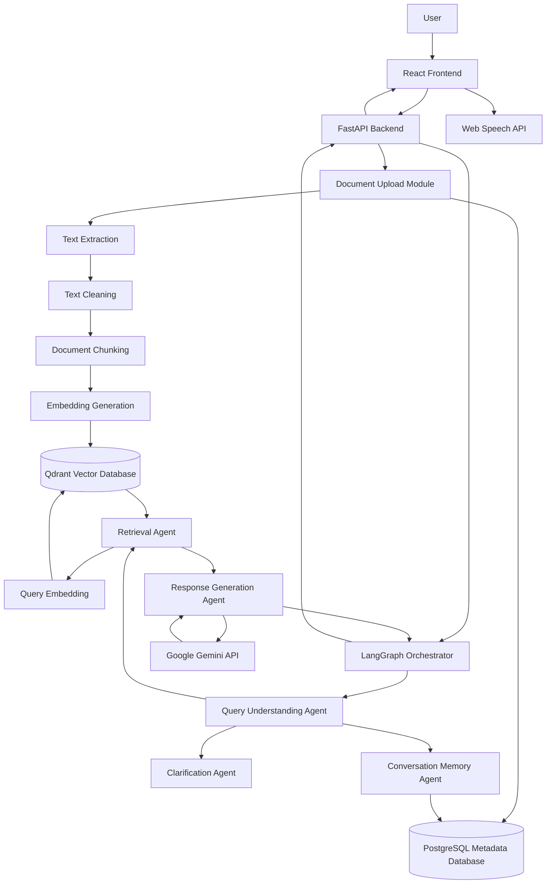
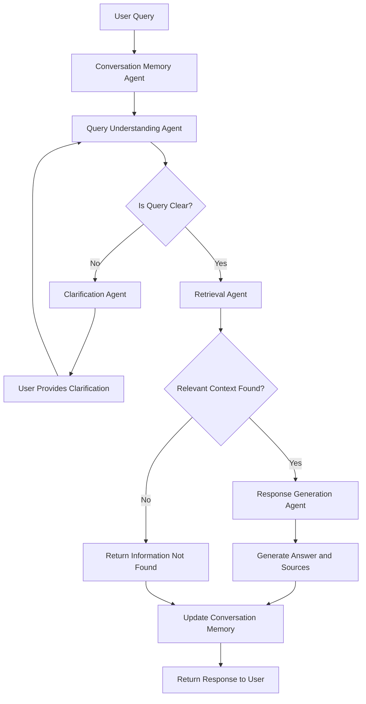
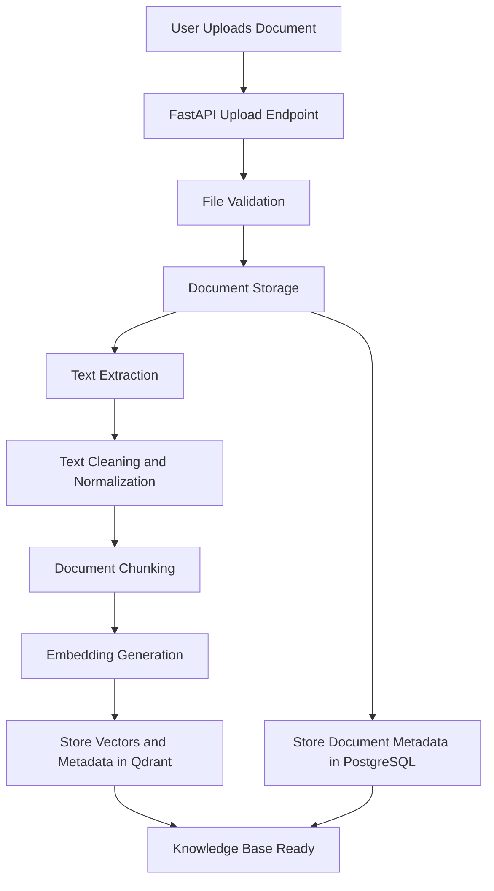
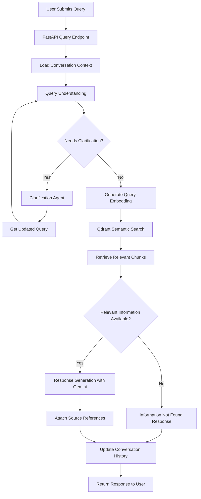

# M1.2 – System Architecture

## Project Title

**Development of AI-Based Knowledge Retrieval Platform with Query Resolution System**

## 1. Introduction

This document describes the proposed system architecture for the AI-Based Knowledge Retrieval Platform with Query Resolution System.

The platform aims to provide an intelligent document-based question-answering system that allows users to upload knowledge documents and retrieve relevant information through natural-language queries.

The proposed architecture combines Retrieval-Augmented Generation (RAG), semantic search, a vector database, a Large Language Model (LLM), and a multi-agent query resolution mechanism.

The architecture is divided into modular components to support maintainability, scalability, and future enhancements.

## 2. Architecture Overview

The proposed system consists of the following major layers:

1. Presentation Layer
2. API and Backend Layer
3. Document Ingestion Layer
4. Data Storage Layer
5. RAG Retrieval Layer
6. Multi-Agent Orchestration Layer
7. LLM and Response Generation Layer
8. Voice Interaction Layer

### 2.1 Presentation Layer

**Technology: React.js**

The presentation layer provides the interface through which users interact with the platform.

Responsibilities:

- Allow users to upload documents.
- Provide a conversational question-and-answer interface.
- Display generated answers.
- Display document names and source references.
- Provide voice input and audio response controls.
- Display document processing and query status.

### 2.2 API and Backend Layer

**Technology: Python and FastAPI**

The backend handles communication between the frontend and the internal system components.

Responsibilities:

- Receive document upload requests.
- Validate file types and sizes.
- Manage document processing requests.
- Accept user questions.
- Communicate with the RAG pipeline.
- Coordinate access to databases and AI services.
- Return generated responses to the frontend.

### 2.3 Document Ingestion Layer

This layer processes uploaded files and converts them into searchable document chunks.

Supported document formats:

- PDF
- DOCX
- TXT
- CSV

Processing stages:

1. Document upload.
2. File validation.
3. Text extraction.
4. Text cleaning and normalization.
5. Document chunking.
6. Embedding generation.
7. Vector database indexing.
8. Document metadata storage.

Proposed extraction libraries:

- PyMuPDF for PDF files.
- python-docx for DOCX files.
- Python file handling for TXT files.
- pandas for CSV files.

### 2.4 Data Storage Layer

The system uses two primary storage components.

**A. Qdrant – Vector Database**

Purpose:

- Store document chunk embeddings.
- Perform semantic similarity searches.
- Retrieve relevant chunks.
- Store associated chunk metadata.

**B. PostgreSQL – Relational Database**

Purpose:

- Store document metadata.
- Maintain document processing status.
- Store conversation records.
- Maintain structured application information.

The original uploaded documents may be stored separately in file storage, while their metadata and processed chunks are maintained in the databases.

### 2.5 RAG Retrieval Layer

This layer retrieves relevant information from the knowledge base.

Responsibilities:

1. Receive the processed user query.
2. Generate a query embedding using the same embedding model used during ingestion.
3. Perform similarity search in Qdrant.
4. Retrieve the top relevant document chunks.
5. Return chunk content, source information, and similarity scores.
6. Provide retrieved context to the response generation component.

### 2.6 Multi-Agent Orchestration Layer

**Technology: LangGraph**

The orchestration layer coordinates the execution of five specialized agents.

It maintains shared workflow state and determines which agent should execute based on the current query and workflow conditions.

The five agents are:

1. Query Understanding Agent
2. Retrieval Agent
3. Response Generation Agent
4. Clarification Agent
5. Conversation Memory Agent

### 2.7 LLM and Response Generation Layer

**Technology: Google Gemini API**

The LLM is used for natural-language understanding and response generation.

Responsibilities:

- Understand user questions.
- Help identify query intent and ambiguity.
- Generate clarification questions when required.
- Generate answers using retrieved document context.
- Produce understandable responses.
- Avoid unsupported claims when relevant information is unavailable.

### 2.8 Voice Interaction Layer

**Technology: Web Speech API**

The voice interaction layer enables users to interact with the platform through speech.

Components:

- SpeechRecognition: Converts spoken queries into text.
- SpeechSynthesis: Converts generated text responses into audio.

Voice interaction will be implemented in the frontend using browser-supported Web Speech API features.

## 3. Overall System Architecture Diagram

## 4. Agent Responsibilities

### 4.1 Query Understanding Agent

**Purpose:** Understand and analyze the user's question before retrieval.

Responsibilities:

- Analyze the natural-language query.
- Identify user intent.
- Extract important keywords and entities.
- Identify the topic or subject of the query.
- Detect ambiguous or incomplete questions.
- Determine whether the query requires clarification.
- Prepare a structured query for the next stage.

Input:

- User query.
- Relevant conversation context.

Output:

- Identified intent.
- Extracted entities.
- Processed query.
- Ambiguity status.
- Suggested next action.

Example:

User query:

"What is the leave policy?"

The agent identifies the intent as retrieving information about an organization's leave policy.

### 4.2 Retrieval Agent

**Purpose:** Retrieve relevant information from the knowledge base.

Responsibilities:

- Receive the processed query.
- Generate query embeddings.
- Search the Qdrant vector database.
- Retrieve relevant document chunks.
- Rank results according to similarity.
- Return document metadata and source information.
- Identify when relevant information is unavailable.

Input:

- Processed user query.
- Query embedding.
- Retrieval configuration.

Output:

- Retrieved document chunks.
- Similarity scores.
- Source document names.
- Page numbers, where available.
- Retrieval status.

### 4.3 Response Generation Agent

**Purpose:** Generate accurate and context-aware answers using retrieved information.

Responsibilities:

- Receive retrieved document chunks.
- Construct a context-aware prompt.
- Send the prompt and query to the LLM.
- Generate a natural-language response.
- Use the retrieved information as the factual basis.
- Include relevant document references.
- Avoid generating unsupported answers.

Input:

- Original user query.
- Retrieved context.
- Relevant conversation context.

Output:

- Generated answer.
- Source references.
- Response status.

### 4.4 Clarification Agent

**Purpose:** Handle ambiguous, incomplete, or unclear user questions.

Responsibilities:

- Identify missing information.
- Generate clarification questions.
- Request additional information from the user.
- Pass the clarified query back into the workflow.
- Prevent unnecessary retrieval when the user's intent is unclear.

Input:

- Original user query.
- Ambiguity information.
- Conversation context.

Output:

- Clarification question.
- Updated query after user response.

Example:

User query:

"Tell me about the application process."

If multiple application processes exist in the knowledge base, the agent may ask:

"Are you asking about the admission application process or the job application process?"

### 4.5 Conversation Memory Agent

**Purpose:** Maintain relevant conversational context across multiple interactions.

Responsibilities:

- Store relevant conversation history.
- Retrieve previous messages when required.
- Maintain context for follow-up questions.
- Associate conversations with their relevant knowledge-base interactions.
- Provide contextual information to other agents.

Input:

- Current user query.
- Conversation identifier.
- Previous conversation history.

Output:

- Relevant conversation context.
- Updated conversation state.

Example:

First question:

"What is the eligibility for the course?"

Follow-up question:

"What documents are required for it?"

The memory agent helps resolve "it" using the previous conversation context.

## 5. Agent Orchestration and Information Flow

### 5.1 Proposed Orchestration Approach

The project will use a supervisor-based orchestration approach implemented using LangGraph.

The orchestrator manages the five agents and controls the transitions between them.

The workflow will use conditional routing so that only the required agents execute for a particular query.

This avoids unnecessary LLM calls and keeps the system modular.

### 5.2 Query Processing Workflow

1. The user submits a question through the React interface.
2. FastAPI receives the query.
3. The Conversation Memory Agent retrieves relevant previous context.
4. The Query Understanding Agent analyzes the query.
5. If the query is ambiguous, the Clarification Agent requests additional information.
6. Once the query is sufficiently clear, the Retrieval Agent searches the knowledge base.
7. Retrieved chunks are checked for relevance.
8. If relevant information is available, the Response Generation Agent generates an answer.
9. If useful information is unavailable, the system returns an appropriate message indicating that the answer could not be found in the uploaded documents.
10. The final response and source references are returned to the frontend.
11. The Conversation Memory Agent updates the conversation history.

### 5.3 Agent Orchestration Diagram

### 5.4 Shared Workflow State

The LangGraph workflow will maintain a shared state containing:

- User query.
- Processed query.
- Conversation ID.
- Relevant conversation history.
- Query intent.
- Ambiguity status.
- Retrieved document chunks.
- Retrieval scores.
- Generated response.
- Source references.
- Workflow status.

The state allows agents to exchange information without tightly coupling their implementations.

## 6. Data Models and Schemas

The system will use structured data models to maintain consistency between modules.

### 6.1 Document Schema

Represents an uploaded document.

| Field | Data Type | Description |
|---|---|---|
| document_id | UUID | Unique document identifier |
| filename | String | Original filename |
| file_type | String | PDF, DOCX, TXT, or CSV |
| file_path | String | Stored document location |
| file_size | Integer | File size in bytes |
| upload_timestamp | DateTime | Upload time |
| processing_status | String | Pending, Processing, Completed, or Failed |

### 6.2 Document Chunk Schema

Represents an individual text segment extracted from a document.

| Field | Data Type | Description |
|---|---|---|
| chunk_id | UUID | Unique chunk identifier |
| document_id | UUID | Parent document identifier |
| chunk_index | Integer | Chunk position |
| chunk_text | Text | Extracted chunk content |
| page_number | Integer / Null | Original page number, when available |
| metadata | JSON | Additional document metadata |

### 6.3 Embedding Schema

Represents the vector representation of a document chunk.

| Field | Data Type | Description |
|---|---|---|
| embedding_id | UUID | Unique embedding identifier |
| chunk_id | UUID | Associated chunk identifier |
| vector | Float Array | Numerical embedding |
| embedding_model | String | Model used to generate the vector |
| dimensions | Integer | Embedding dimensions |

Initial embedding model: all-MiniLM-L6-v2.

Expected vector dimensions: 384.

### 6.4 Query Schema

Represents a user-submitted question.

| Field | Data Type | Description |
|---|---|---|
| query_id | UUID | Unique query identifier |
| conversation_id | UUID | Associated conversation |
| original_query | Text | Original user question |
| processed_query | Text | Refined query |
| query_timestamp | DateTime | Submission time |
| query_status | String | Received, Processing, or Completed |

### 6.5 Retrieval Result Schema

Represents the output of semantic retrieval.

| Field | Data Type | Description |
|---|---|---|
| result_id | UUID | Unique result identifier |
| query_id | UUID | Associated query |
| chunk_id | UUID | Retrieved chunk identifier |
| document_id | UUID | Source document identifier |
| similarity_score | Float | Similarity score |
| retrieved_text | Text | Retrieved content |
| source_reference | JSON | Document and page information |

### 6.6 Response Schema

Represents the generated answer.

| Field | Data Type | Description |
|---|---|---|
| response_id | UUID | Unique response identifier |
| query_id | UUID | Associated query |
| answer | Text | Generated answer |
| source_references | JSON | Supporting document references |
| response_status | String | Success, Not Found, or Error |
| created_at | DateTime | Response timestamp |

### 6.7 Conversation Memory Schema

Represents conversational context.

| Field | Data Type | Description |
|---|---|---|
| conversation_id | UUID | Unique conversation identifier |
| message_id | UUID | Unique message identifier |
| role | String | User or Assistant |
| message_content | Text | Message content |
| timestamp | DateTime | Message timestamp |

## 7. End-to-End Data Flow

### 7.1 Document Ingestion Flow

### 7.2 Query and Response Flow

## 8. Proposed API Endpoints

The backend will expose REST APIs for communication with the frontend.

| Method | Endpoint | Purpose |
|---|---|---|
| POST | /api/documents/upload | Upload a document |
| GET | /api/documents | Retrieve uploaded document list |
| GET | /api/documents/{document_id} | Retrieve document details |
| DELETE | /api/documents/{document_id} | Delete a document and its indexed chunks |
| POST | /api/query | Submit a user question |
| GET | /api/conversations/{conversation_id} | Retrieve conversation history |
| GET | /api/health | Check backend health |

These endpoints represent the proposed API design and may be refined during implementation.

## 9. Technology Stack

| Layer | Technology | Responsibility |
|---|---|---|
| Frontend | React.js | User interface |
| Backend | Python, FastAPI | API development |
| LLM | Google Gemini API | Query understanding and response generation |
| RAG Framework | LangChain | Document processing and retrieval |
| Orchestration | LangGraph | Multi-agent coordination |
| Embeddings | Sentence Transformers | Generate text embeddings |
| Embedding Model | all-MiniLM-L6-v2 | 384-dimensional vector generation |
| Vector Database | Qdrant | Semantic search and vector storage |
| Relational Database | PostgreSQL | Structured metadata and conversation records |
| PDF Processing | PyMuPDF | PDF text extraction |
| DOCX Processing | python-docx | DOCX text extraction |
| CSV Processing | pandas | CSV data processing |
| Voice | Web Speech API | Speech recognition and synthesis |
| Testing | pytest and Postman | Testing and API validation |
| Deployment | Docker | Containerization |
| Version Control | Git and GitHub | Source code management |

## 10. Design Considerations

The following considerations will guide implementation:

### 10.1 Modularity

Each component will have a clearly defined responsibility to simplify testing and future modifications.

### 10.2 Scalability

The ingestion pipeline, retrieval pipeline, and agent orchestration layer will be separated to support future enhancements.

### 10.3 Reliability

The system will handle invalid files, failed extraction, unavailable retrieval results, and LLM errors gracefully.

### 10.4 Response Grounding

Generated responses should be based on retrieved document content. Source references will be included to improve transparency.

### 10.5 Conversation Context

Conversation identifiers will be used to associate user queries with their relevant interaction history.

### 10.6 Security

- Validate uploaded file types and sizes.
- Keep API keys in environment variables.
- Avoid exposing secrets in source code.
- Validate user input.
- Restrict access to uploaded documents and conversation data.

## 11. Expected System Output

The proposed system is expected to provide:

1. Successful document uploads.
2. Processed and indexed document chunks.
3. Semantic retrieval of relevant content.
4. Natural-language answers based on uploaded documents.
5. Source document references.
6. Clarification for ambiguous questions.
7. Context-aware answers to follow-up questions.
8. Voice-based query and response support.

## Additional Architecture Components

### 1. Document Storage Module

The Document Storage Module maintains the original uploaded documents.

Responsibilities:
- Store uploaded PDF, DOCX, TXT, and CSV files.
- Maintain the relationship between original files and processed document chunks.
- Support document retrieval and deletion.
- Maintain document identifiers for tracking.

### 2. Response and Citation Generation Module

This module ensures that generated answers are accompanied by relevant source information.

Responsibilities:
- Associate retrieved chunks with their original documents.
- Include source document names and page numbers where available.
- Provide references supporting generated responses.
- Indicate when sufficient supporting information is unavailable.

### 3. Confidence and Retrieval Transparency Module

This module provides visibility into the retrieval process.

Responsibilities:
- Display similarity scores for retrieved chunks.
- Identify the documents used to generate an answer.
- Indicate when retrieval results are weak or insufficient.
- Support transparent handling of unavailable information.

Similarity scores will be treated as retrieval relevance indicators, not guaranteed probabilities of answer correctness.

### 4. Query Analytics and Knowledge Gap Detection Module

This module analyzes query activity to identify potential gaps in the knowledge base.

Responsibilities:
- Record user queries and retrieval outcomes.
- Identify frequently unanswered questions.
- Track queries for which relevant document content was not found.
- Generate insights that can guide future knowledge base improvements.

### 5. Knowledge Base Update Module

This module manages changes to the knowledge base.

Responsibilities:
- Support adding new documents.
- Support deleting existing documents.
- Allow updated documents to be processed and indexed again.
- Maintain document processing status.
- Ensure that outdated vector records are removed or replaced when documents are updated.

### 6. Voice Interaction Modules

The voice interaction functionality consists of two components.

**Speech-to-Text Module:**
- Uses the Web Speech API SpeechRecognition interface.
- Converts spoken questions into text.
- Passes recognized text to the backend query endpoint.

**Text-to-Speech Module:**
- Uses the Web Speech API SpeechSynthesis interface.
- Converts generated text responses into spoken audio.
- Allows users to listen to answers.

### 7. Communication and Data Flow Between Components

The frontend communicates with the backend using REST APIs.

The backend coordinates document processing, retrieval, database operations, and agent execution.

The ingestion pipeline sends generated embeddings and metadata to Qdrant and stores structured document information in PostgreSQL.

The LangGraph orchestrator coordinates the five agents using shared workflow state.

The Retrieval Agent communicates with Qdrant to retrieve relevant document chunks. The Response Generation Agent uses the retrieved context and the LLM to generate an answer.

The final response, source references, and retrieval status are returned to the frontend.

The analytics module records relevant query outcomes to help identify knowledge gaps and improve the knowledge base over time.

## 12. Conclusion

The proposed architecture establishes a modular foundation for the AI-Based Knowledge Retrieval Platform with Query Resolution System.

The architecture combines document ingestion, embedding generation, vector search, RAG-based response generation, and multi-agent orchestration.

The five specialized agents will collaborate through LangGraph to understand user queries, retrieve relevant information, generate grounded answers, clarify ambiguity, and maintain conversational context.

This architecture will guide the implementation of the Knowledge Base Ingestion Module and RAG Retrieval Pipeline in the remaining subdivisions of Milestone 1.

## 13. References

1. Microsoft Learn – Design and Develop a RAG Solution: https://learn.microsoft.com/en-us/azure/architecture/ai-ml/guide/rag/rag-solution-design-and-evaluation-guide
2. LangGraph Documentation: https://docs.langchain.com/oss/python/langgraph/overview
3. LangChain Documentation: https://docs.langchain.com/oss/python/langchain/overview
4. FastAPI Documentation: https://fastapi.tiangolo.com/
5. Qdrant Documentation: https://qdrant.tech/documentation/
6. Sentence Transformers Documentation: https://www.sbert.net/
7. PostgreSQL Documentation: https://www.postgresql.org/docs/
8. MDN Web Speech API: https://developer.mozilla.org/en-US/docs/Web/API/Web_Speech_API